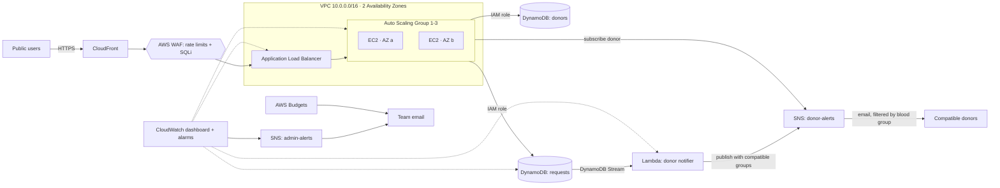

# HaemaLink: Blood Donor Finder on AWS

**BCSE355L AWS Solutions Architect — Course Project (2 members)**

When a patient needs blood urgently, families post on WhatsApp groups and call random contacts for hours.
**Blood Donor Finder** fixes that:

- **Donors register** with blood group, city and email.
- **Anyone can search** for donors whose blood is compatible with the patient (e.g. an A+ patient can take A+, A-, O+, O-).
  Donors who gave blood in the last 90 days are marked "not ready yet". Phone numbers are partly hidden.
- **Post an urgent request** → every compatible donor gets an **email alert within seconds**.

Everything runs on AWS and is created by one CloudFormation template.

---

## Architecture



**How the alert works (key viva point)**
1. A request for **B+** is saved to the `requests` table.
2. The **DynamoDB Stream** sends the new item to **Lambda**.
3. Lambda looks up who can donate to B+ → `["B+", "B-", "O+", "O-"]` and publishes **one** SNS message with that list.
4. Each donor's SNS subscription has a **filter policy** with their own group (e.g. `{"bloodGroup": ["O-"]}`).
   SNS delivers the email only to donors whose group is in the list. No loops, no per-donor code.

---

## AWS services used (13)

| # | Service | Syllabus module | Role in the project |
|---|---|---|---|
| 1 | **IAM** | 1 – Foundations & IAM | EC2 role and Lambda role with least-privilege policies (no access keys anywhere); read-only IAM group for team members |
| 2 | **Amazon VPC** | 3 – Networking | Custom VPC, 2 subnets in 2 AZs, route table, internet gateway, security groups (Internet→ALB:80, ALB→EC2:3000 only), gateway endpoints for DynamoDB & S3 |
| 3 | **Amazon EC2** | 2 – Compute | Runs the Node.js web app (Amazon Linux 2023, launch template, IMDSv2) |
| 4 | **Elastic Load Balancing (ALB)** | 2 – Compute | Spreads traffic over instances in 2 AZs, health-checks `/health` |
| 5 | **Auto Scaling** | 2 – Compute | 1–3 instances, scales at 50% CPU (emergency appeals go viral); rolling updates |
| 6 | **Amazon DynamoDB** | 4 – Databases | `donors` table and `requests` table (on-demand, encrypted, TTL deletes requests after 7 days) |
| 7 | **DynamoDB Streams** | 4 – Databases | Every new request is streamed to Lambda to trigger alerts |
| 8 | **Amazon SNS** | 7 – App Integration | Donor-alert topic with blood-group filter policies; admin-alert topic for alarms |
| 9 | **Amazon CloudFront** | 3 – Content Delivery | Free HTTPS, edge caching of the page; `/api/*` never cached so data is always live |
| 10 | **Amazon CloudWatch** | 5 – Management | Dashboard (requests, errors, latency, CPU, instances, DynamoDB, alerts sent) + 3 alarms |
| 11 | **AWS Budgets** | 5 – Cost Management | Monthly budget, emails at 80% actual and 100% forecast |
| 12 | **AWS Lambda** | 2 – Compute (serverless) | Reads the stream, works out compatible groups, publishes the alert |
| 13 | **AWS WAF** | 6 – Security | On the ALB: max 10 blood requests per IP per 5 min (stops fake-emergency spam), max 500 requests per IP per 5 min (stops bots), AWS-managed SQL-injection rules. Blocked users get a friendly 429 message |

Also used: **S3** (stores the app package servers download), **Systems Manager** (Session Manager instead of SSH,
Run Command for the load test), **CloudFormation** (infrastructure as code).

---

## Files

```
blood-donor-finder/
├── app/server.js            # API: search donors, register, post request (runs locally too)
├── app/public/index.html    # The website (Find donors / Request blood / Become a donor)
├── infra/template.yaml      # CloudFormation — every AWS resource
├── deploy.sh                # One command deploy (run in AWS CloudShell)
├── teardown.sh              # Deletes everything after the demo
├── demo-autoscale.sh        # Load test to show Auto Scaling live
├── demo-waf.sh              # Spam test to show WAF blocking live
├── prebuilt/app.zip         # Ready app package (for console-only deploy)
└── AGENT_INSTRUCTIONS.md    # Step-by-step deploy guide for an AI browser agent
```

---

## Deploy (only AWS needed)

1. AWS Console → region **Asia Pacific (Mumbai) ap-south-1**.
2. Open **CloudShell** (`>_` icon, top bar) → **Actions → Upload file** → `blood-donor-finder.zip`.
3. Run:
   ```bash
   unzip blood-donor-finder.zip && cd blood-donor-finder
   chmod +x *.sh
   ./deploy.sh your.email@gmail.com
   ```
4. ~10 minutes later it prints **WebsiteURL** → open it (give EC2 ~3 more minutes to boot if you see 502).
5. Confirm the "AWS Notification – Subscription Confirmation" email (admin alarms).

The site starts with 10 fictional demo donors so search works immediately.

**After the demo: `./teardown.sh`** — deletes everything so credits aren't used.

---

## Demo script for the review (≈5 minutes)

**Before the review (once):** register yourself as a donor with **O-** (O- can give to everyone, so every request reaches you)
and click *Confirm subscription* in the AWS email on your phone.

1. **Find donors** → click **A+** → shows A+, A-, O+, O- donors. Explain blood compatibility and the 90-day rule.
2. **Request blood** → fill the form for any group (e.g. B+) → *Send alert to donors*.
3. **Show your phone** → "URGENT: B+ blood needed…" email arrives in seconds. 🎉
4. Explain the flow: DynamoDB → Stream → Lambda → SNS filter policy.
5. **Auto Scaling** → in CloudShell run `./demo-autoscale.sh 8` → instance count goes 1 → 2 → 3.
6. **Console tour** → VPC & security groups, IAM role (only 3 DynamoDB actions), DynamoDB tables, Lambda logs,
   SNS subscriptions with filter policy, CloudWatch dashboard, Budgets.
7. **WAF** → in CloudShell run `./demo-waf.sh` → after ~10 fake posts it prints `429 BLOCKED BY AWS WAF`.
   Refresh the site in your browser: it still works for you (different IP). Show WAF → Web ACLs → `blood-donor-waf`
   → Traffic overview. (The script sends invalid data, so no donor gets a spam email.)
8. **High availability** → terminate the EC2 instance → Auto Scaling replaces it; site keeps working.

---

## Cost (with AWS credits)

Roughly **$0.06/hour (~$1.50/day)** while deployed — mostly the load balancer, plus ~$0.01/hour for WAF. DynamoDB, Lambda, SNS email and
CloudFront are a few cents at most. Deploy → demo → teardown costs under $1. The $5 Budget emails you if you forget.

---

## Points for the report

**Shared Responsibility Model**
- *AWS:* data centres, hardware, network, hypervisor, and running DynamoDB / Lambda / SNS / CloudFront.
- *Us:* IAM roles and policies, security group rules, input validation, hiding donor phone numbers and keeping
  emails out of the database (stored only in SNS), encryption settings, OS patching (fresh AMI on every launch).

**Well-Architected Framework**
- *Operational excellence:* all infrastructure in CloudFormation; one-command deploy/teardown; dashboard + alarms.
- *Security:* least privilege, no stored keys, no SSH port (Session Manager), IMDSv2, DynamoDB encryption, HTTPS,
  WAF rate limiting and SQL-injection protection.
- *Reliability:* 2 AZs, ALB health checks, Auto Scaling self-healing, DynamoDB point-in-time recovery.
- *Performance:* CloudFront edge caching, DynamoDB millisecond reads, Auto Scaling on CPU.
- *Cost:* on-demand DynamoDB, serverless Lambda, TTL auto-cleanup, scale-in to 1 instance, Budgets.
- *Sustainability:* scales down when idle.

**Likely viva questions**
- *Why DynamoDB, not RDS?* Simple key-value data, no joins, and Streams give change events for free.
- *Why Lambda for alerts?* Decoupled: alerts go out even if the web servers are busy or being replaced.
- *Why one SNS topic with filter policies?* No need for 8 topics or a loop over donors; SNS does the matching.
- *Why CloudFront?* Free HTTPS, faster load anywhere in India, absorbs traffic spikes.
- *Why EC2 in public subnets?* Avoids a NAT Gateway (~$32/month). EC2 still only accepts traffic from the ALB.
  In production we would use private subnets + NAT.

## Limitations & future scope (put this on a slide)

This is a college project, so some real-world pieces are intentionally left out. Each one has a clear AWS fix:

| Limitation | Real-world fix on AWS |
|---|---|
| Anyone can post a request (WAF limits spam, but there's no login) | Hospital login with **Amazon Cognito** + manual hospital verification |
| Donor blood group is self-declared | OTP verification; blood group confirmed by a licensed blood bank |
| Requester's phone number is public on requests | Show contact details only to logged-in donors |
| Email alerts only | **SNS SMS** for donors without email |
| CloudFront → ALB hop is HTTP | Custom domain + **ACM** certificate on the ALB, HTTPS end to end |
| EC2 in public subnets (avoids NAT cost) | Private subnets + NAT Gateway |
| WAF rate limit uses the forwarded IP header | Put WAF on CloudFront (us-east-1) to see the true client IP |
| Legal: donations must go through licensed blood banks; personal data under India's DPDP Act 2023 | Blood-bank partnerships, consent screen, "delete my data" option |

WAF rate limiting against fake requests, donation history and reminders when a donor becomes eligible again.

---

## Team split

| Member | Owns |
|---|---|
| Member 1 | VPC, security groups, IAM, EC2, ALB, Auto Scaling, CloudFront, load-test demo |
| Member 2 | Web app, DynamoDB + Streams, Lambda, SNS filter policies, CloudWatch, Budgets |

## Run locally (optional)
```bash
cd app && npm install && npm start     # http://localhost:3000 — alerts print in the terminal
```

## Troubleshooting
- **502/503 after deploy:** EC2 still booting, wait 3 minutes.
- **Still failing:** EC2 → instance → Connect → Session Manager → `sudo journalctl -u blood -n 50`.
- **No alert email:** click *Confirm subscription* in the AWS email first; check Lambda → Monitor → logs.
- **WAF error on deploy (e.g. not available on the account):** delete the `WebACL` and `WebACLAssociation`
  blocks and the WAF dashboard widget from the template, redeploy (project still has 12 services).
- **Budget error on deploy:** delete the `MonthlyBudget` block from the template and create the budget in Billing → Budgets.
